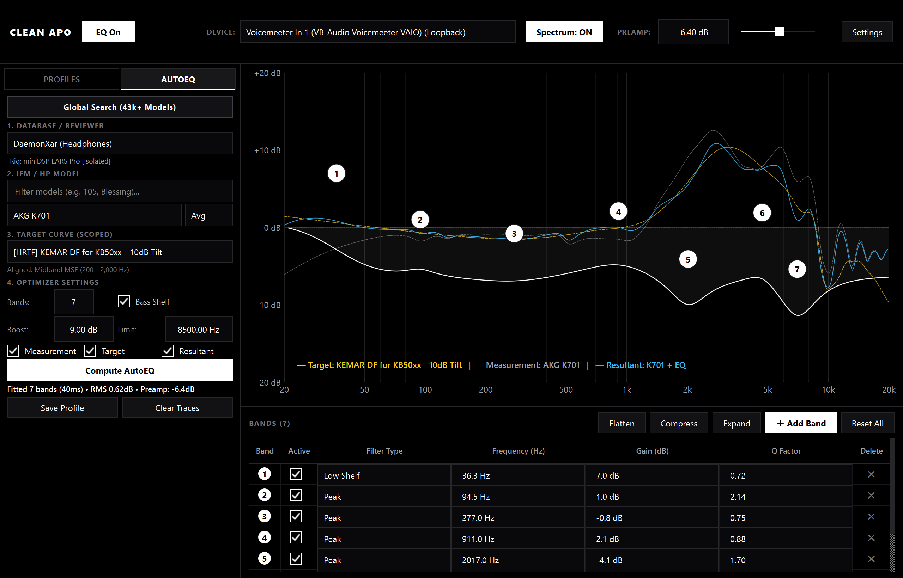

# Clean APO

A native, high-performance desktop equalizer application for Windows built with **PyQt6** and **pyqtgraph**, featuring Robert Bristow-Johnson's Audio EQ Cookbook biquads, live Windows WASAPI audio loopback spectrum analysis, and seamless direct integration with **Equalizer APO**.



---

## Download & Installation (Standalone App)

**No Python, terminal, or Peace installation required!**

1. Go to the [**Releases**](https://github.com/pi-nf/clean-apo/releases) tab.
2. Download the latest `CleanAPO.exe` (or `CleanAPO-Windows-x64.zip`).
3. Double-click `CleanAPO.exe` to run.

> [!NOTE]
> **Do I need Peace installed?**
> **No.** Clean APO is a 100% modern, standalone replacement for Peace Equalizer. It writes directly to Equalizer APO and automatically configures `Include: clean_apo_generated.txt`. Peace is never needed.
>
> If you do not have Equalizer APO installed on your PC, Clean APO will still run in standalone mode for curve design, AutoEQ optimization, REW/Peace importing, and live audio spectrum analysis. To apply your EQ profiles system-wide to Windows audio, simply install [Equalizer APO](https://sourceforge.net/projects/equalizerapo/) (free & open source).

---

## Features

- **Minimalist Studio Black & White Aesthetic**:
  - Pure black background (`#000000`), architectural 1px divider lines (`#27272a`), zero rounded borders, and clean typography.
  - Crisp monochrome palette with high-contrast white response curves and active badges.
- **Robert Bristow-Johnson Audio EQ Cookbook Engine**:
  - Exact complex frequency response $H(f)$ vectorized in NumPy across 1,000 log-spaced frequency points (20 Hz to 20,000 Hz).
  - Supported filter types: **Peaking EQ (PK)**, **Low Shelf (LSC)**, **High Shelf (HSC)**, **High Pass (HPQ)**, and **Low Pass (LPQ)**.
  - Sub-millisecond composite curve calculation (~0.17 ms for 10 filters), rendering smoothly at 60+ FPS while dragging.
- **Draggable Interactive Nodes & Zero-Trail Display**:
  - Exact circular hitboxes preventing any overlapping click interference between adjacent nodes.
  - Top-left HUD banner displaying real-time frequency, gain, filter type, and Q factor with zero ghost trails.
  - Left-click + drag to position; mouse scroll wheel to adjust Q factor; right-click context menu to change type, toggle bypass, reset, or delete.
  - Double-click empty canvas to instantly spawn a new band.
- **Live Desktop Audio Spectrum Analyzer (WASAPI Loopback)**:
  - Built-in **Device Selector** dropdown in the header to route capture to your active playback endpoint (Speakers, Headphones, Voicemeeter Input, etc.).
  - 2,048-sample Hanning FFT with exponential decay smoothing.
  - Subtle translucent white curve underlay that visualizes audio playback in real time.
- **Profile Animations with Cubic Smoothing**:
  - **Sidebar Selection**: Sliding white indicator bar with `InOutCubic` easing.
  - **Graph Sweep**: Switching profiles triggers a left-to-right wave entrance animation with bands popping in sequentially.
  - **Preamp Slider**: Smooth cubic animation during profile transitions.
- **Universal EQ Bypass Toggle**:
  - Dedicated "EQ: ON" / "EQ: BYPASS" button. When bypassed, the graph dims to muted dashed grey and Equalizer APO immediately disables processing.
- **Native AutoEQ Optimization & Squiglink Database Integration**:
  - **Global Database Search (43,000+ Measurements)**: Fast modal search across 148 reviewer databases indexing 43,600+ IEM and headphone models (including over-ear headphones like **Meze 105 AER**, Sennheiser HD600, Focal, etc.). Displays the model name, type, reviewer, coupler rig, and all available target curves for that provider. One click instantly loads the model and aligns target traces.
  - **Expanded Provider Hierarchy & Over-Ear Headphone Databases**: Full support for both IEM databases and specialized over-ear headphone measurement databases (`DaemonXar`, `Gadgetry Tech (Headsets)`, `Super* Review (Headphones)`, `Kuulokenurkka`, `Audio Amigo`, `Side Salad Audio`, `listener`, `Hangout.Audio (Headphones)`).
  - **Strict Rig Isolation**: UI strictly isolates targets and raw measurements to the selected reviewer's measurement coupler (e.g. IEC 60318-4 / 711 clone vs GRAS vs BK5128 vs miniDSP EARS) to eliminate coupler mismatch errors.
  - **Zero UI Lag & High-Performance Debouncing**: Keystroke typing in the model search filter is debounced (180 ms) and capped to top matches, eliminating dropdown freeze. Provider switching utilizes an in-memory RAM cache (`_in_memory_indices`) for instantaneous 0 ms switching.
  - **Compact Responsive Sidebar**: Auto-resizing viewport synchronizer prevents vertical and horizontal scrollbars, ensuring all spinboxes, checkboxes, and buttons remain crisp and visible.
  - **Local Disk Caching**: Automatic caching of database indices (`phone_book.json`, `config.js`) and raw measurement/target `.txt` curves in `~/.clean_apo_cache/` for instant load times and offline operation.
  - **Multi-Sample & Channel Support**: Select between Average (L+R), Left (L), or Right (R) channels with multi-variant / insert sample support.
  - **Native SciPy Optimization Engine**: Fast local curve fitting using trust-region reflective least squares (`scipy.optimize.least_squares`). Fits 3 to 10 bands with optional Low Shelf bass correction and frequency weighting (100 Hz to 6 kHz prioritized, >8.5 kHz restricted to prevent coupler resonance artifacts). Solves in ~20–40 ms without external web endpoints.
  - **Interactive Overlays & APO Sync**: Live visual overlays for raw measurement and target compensation traces directly on the canvas; optimized filters sync instantly to the interactive plot, bottom table, and debounced Equalizer APO output file with digital anti-clipping preamp calculation.
- **Universal EQ Importer**:
  - Import profiles from Equalizer APO `.txt`, Room EQ Wizard (REW) exports, Peace `.peace` configurations, or `.json` presets.
- **Batch Editing Tools**:
  - **Flatten**: Resets all band gains to 0 dB.
  - **Compress 50%**: Halves all band gains to compress the dynamic range.
  - **F2 Shortcut**: Press F2 anywhere to quickly rename the active profile.
- **Equalizer APO Direct Integration**:
  - Automatically writes filter sets in standard Equalizer APO syntax with 50 ms debounce.
  - Target: `C:\Program Files\EqualizerAPO\config\clean_apo_generated.txt` (configurable in Settings, with fallback to `./eq_output.txt`).

---

## Equalizer APO Setup (One-Time)

To apply the EQ to Windows audio, Clean APO automatically adds the include directive to your Equalizer APO configuration. If setting up manually, add this line to `C:\Program Files\EqualizerAPO\config\config.txt`:

```text
Include: clean_apo_generated.txt
```

---

## Developer Quick Start (Running from Source)

If you wish to develop or modify Clean APO locally:

```powershell
Set-ExecutionPolicy -Scope Process -ExecutionPolicy Bypass
.\run.ps1
```

To compile a standalone `.exe`:

```powershell
.\build.ps1
```

---

## Shortcuts & Controls

| Action | Control |
| :--- | :--- |
| **Move Frequency & Gain** | Left-click and drag a node |
| **Adjust Q Factor** | Scroll mouse wheel over a node |
| **Node Context Menu** | Right-click a node |
| **Add New Band** | Double-click on any empty area of the canvas |
| **Rename Profile** | Press **F2** |
| **Flatten All Bands** | Click "Flatten" in the filter table header |
| **Compress All Bands** | Click "Compress 50%" in the filter table header |
| **Universal EQ Bypass** | Click "EQ: ON / EQ: BYPASS" in the top header |
| **Select Audio Device** | Use the "DEVICE" dropdown in the top header |
| **Import EQ Profile** | Click "Import EQ" in the sidebar |
| **AutoEQ Global Search** | Click "Global Model Search" in the AutoEQ sidebar |
| **Offline Library Sync** | Click "Offline Sync" in the AutoEQ sidebar |
